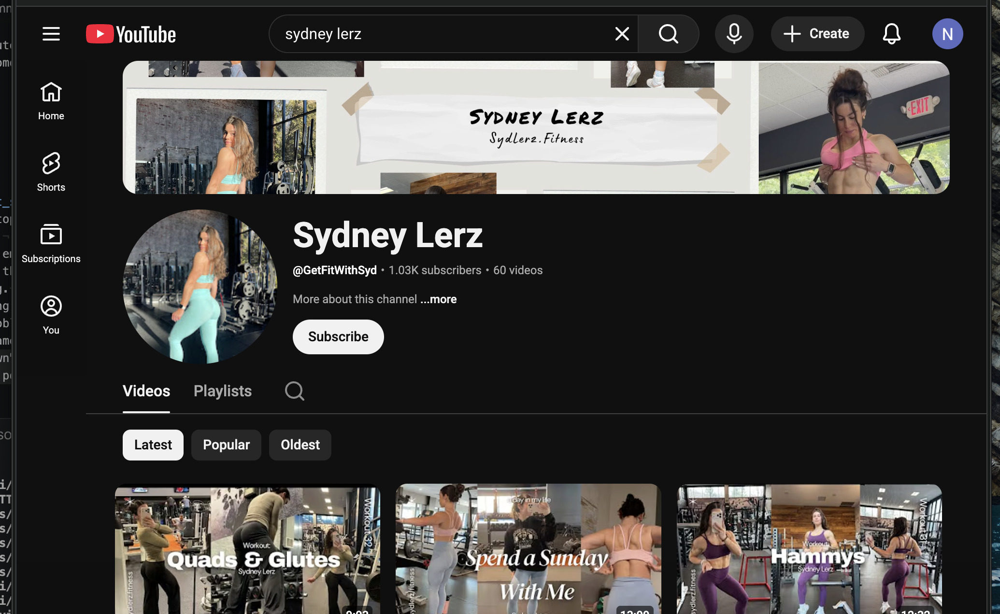

# Skill 05 — Product Recommendation & Creative Brief
**Workflow Phase:** Phase 3 — Creator Onboarding
**Data Required:** `data/creators.csv`, `data/crm_records.csv`, `data/hypeauditor_intake_log.csv`
**Skill Type:** LLM-assisted (product selection + creative brief generation)
**Trigger:** Creator has responded positively to outreach

---

## Goal
Tell the account manager exactly what to send and what to ask the creator to post. Takes the creator's niche, audience demographics, and deal type and produces a ready-to-act brief — product line, specific items, creative direction, and (for affiliates) a promo code.

---

## When to Use This Skill
Use this skill when:
- A creator replies positively to the outreach message from Skill 03
- A manager asks: *"What should we send [creator name]?"*
- Onboarding a new cohort of gifting or affiliate creators

Only runs for `gift_seeding` and `affiliate` deal types. For paid creative or ambassador deals, use a separate paid brief process.

---

## Step-by-Step Instructions

### Step 1 — Confirm deal type
Check `suggested_deal_type` in `crm_records.csv`. If it is not `gift_seeding` or `affiliate`, stop and flag that this skill does not apply.

### Step 2 — Load creator data
Call `load_creator_brief_data(creator_id)` from `brief_helpers.py`.

This merges:
- Creator niche, tier, handle from `creators.csv`
- Deal type from `crm_records.csv`
- Audience gender split and top country from `hypeauditor_intake_log.csv`

### Step 3 — Select product line
Call `recommend_product_line(niche, gender_male_pct)` from `brief_helpers.py`.

Selection logic:

| Condition | Product Line |
|---|---|
| Niche contains bodybuilding / powerlifting / strength | LIFTING |
| Niche contains running / cardio / outdoor | RUNNING |
| Niche contains yoga / pilates | ADAPT |
| Audience < 45% male (mostly female) | ADAPT |
| All other cases | TRAINING |

### Step 4 — Generate creative brief
Call `generate_creative_brief(creator_data, product_line)` from `brief_helpers.py`.

The LLM writes a brief covering:
- **Key message** — what Gymshark wants the audience to feel or do
- **Content format** — specific format for their platform and niche (e.g. YouTube workout integration, Instagram try-on Reel)
- **Must include** — two brand points they must mention
- **Avoid** — one tone or claim to steer clear of
- **Posting window** — best timing for their audience

### Step 5 — Assign promo code (affiliate only)
If `deal_type = affiliate`, call `generate_promo_code(creator_name)` from `brief_helpers.py`.

Format: `GS` + first 4 letters of name + 2-digit number → e.g. `GSNAOM47`

Commission rate: 12% of attributed revenue, tracked via UTM link + promo code redemptions.

### Step 6 — Output the brief
Call `generate_full_brief(creator_id)` from `brief_helpers.py` to produce the complete formatted output.

---

## Output Format

**Gift seeding:**
```
PRODUCT BRIEF — [Creator Name] (@[handle])
=======================================================
Deal type:    GIFT SEEDING
Tier:         [Tier]
Niche:        [Niche]

PRODUCT RECOMMENDATION
  Line:   [LINE] — [description]
  Send:   [item 1], [item 2], [item 3]

CREATIVE BRIEF
KEY MESSAGE: [...]
CONTENT FORMAT: [...]
MUST INCLUDE: [...]
AVOID: [...]
POSTING WINDOW: [...]
```

**Affiliate (adds promo code block):**
```
PRODUCT BRIEF — [Creator Name] (@[handle])
=======================================================
Deal type:    AFFILIATE
...

AFFILIATE DETAILS
  Promo code:  GS[NAME][NN]
  Commission:  12% of attributed revenue
  Tracking:    UTM link + promo code redemptions

CREATIVE BRIEF
...
```


## Edge Cases
- If `deal_type` is not `gift_seeding` or `affiliate`, output a clear message and stop — do not generate a brief for paid or ambassador deals.
- If `ai_discovery_notes` is empty, the LLM brief will be slightly more generic — flag this for the account manager to personalise before sending.
- For nano creators on gifting: remind the account manager there is no posting obligation. Do not phrase the brief as an instruction — frame it as a suggestion.
- If `top_country` is "Unknown", default to GB (Gymshark's home market) for posting window advice.
